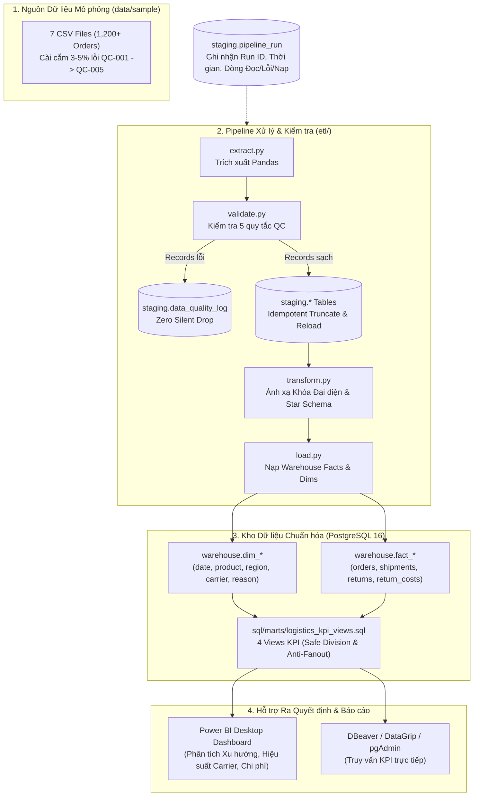

# Smart Logistics Analytics & Decision Support System (SLADSS)

> **Enterprise Hybrid Data Platform & Decision Support System in Reverse Logistics**  
> Dự án Data Platform & Analytics kết hợp 3 mảng năng lực kỹ thuật: **Data Engineering (DE)**, **Data Analysis (DA)**, và **Business Analysis (BA)**.

[](docker-compose.yml)
[](Dockerfile)
[](sql/ddl/)
[-orange)](sql/ddl/02_star_schema.sql)
[-brightgreen?logo=pytest)](tests/)
[](.specify/memory/constitution.md)

---

## 1. 🌐 Bản chất Mô hình Enterprise Hybrid & Phạm vi Dự án

Dự án được xây dựng theo mô hình **Enterprise Hybrid**:
- 🏢 **Hạ tầng & Kỹ thuật Thật 100%**: Sử dụng container hóa Docker Compose, PostgreSQL 16 Data Warehouse phân lớp (`staging`, `warehouse`, `marts`), hệ thống ghi nhận kiểm toán chạy (`pipeline_run`), giám sát chất lượng dữ liệu (`data_quality_log`), và pipeline Python tuân thủ nguyên tắc **Idempotent** (tái chạy an toàn không sinh trùng bản ghi).
- 🎲 **Dữ liệu Nghiệp vụ Mô phỏng (Synthetic Data, Zero PII)**: Nhằm bảo mật và phục vụ đào tạo/portfolio, 100% dữ liệu kinh doanh được sinh bằng thuật toán ngẫu nhiên có kiểm soát (1.200+ đơn hàng, chu kỳ 12 tháng), mã hóa danh tính khách hàng dạng `CUST_<UUID>` không chứa bất kỳ PII (Personally Identifiable Information) thật nào.
- 🔍 **Cài cắm Lỗi Logic để Kiểm thử Data Observability**: Bộ sinh dữ liệu cố tình chèn 3–5% lỗi nghiệp vụ kinh điển (khóa chính rỗng, chi phí âm, sai lệch thứ tự thời gian, trạng thái ngoài enum, khóa ngoại mồ côi) để kiểm chứng khả năng bắt lỗi và ghi nhật ký tự động của pipeline.

---

## 2. 🏛️ Kiến trúc Hệ thống & Luồng Dữ liệu (Data Flow)

### Sơ đồ Luồng Dữ liệu End-to-End


---

## 3. 📊 Mô hình Dữ liệu Chi tiết (Extracted from Codebase)

### 3.1. Phân lớp Bảng Staging & Kiểm toán (`sql/ddl/01_staging_and_logs.sql`)
| Tên bảng | Schema | Vai trò & Đặc điểm |
|---|---|---|
| `pipeline_run` | `staging` | Ghi nhận lịch sử mỗi lần chạy: `run_id`, `started_at`, `ended_at`, `status` (`SUCCESS`/`FAILED`), `rows_read`, `rows_valid`, `rows_rejected`, `rows_loaded`. |
| `data_quality_log` | `staging` | Lưu chi tiết vi phạm chất lượng dữ liệu: `log_id`, `run_id`, `source_file`, `row_number`, `rule_code`, `column_name`, `raw_value`, `message`. |
| `orders` | `staging` | Bảng thô đơn hàng (`order_id`, `order_date`, `customer_key`, `product_id`, `region_id`, `carrier_id`, `order_value`). |
| `shipments` | `staging` | Bảng thô thông tin giao hàng (`shipment_id`, `order_id`, `carrier_id`, `shipped_at`, `delivered_at`, `delivery_status`, `delivery_attempts`). |
| `returns` | `staging` | Bảng thô sự kiện trả hàng (`return_id`, `order_id`, `return_date`, `return_reason`, `return_status`). |
| `return_costs` | `staging` | Bảng thô chi phí hoàn trả (`cost_id`, `return_id`, `cost_type`, `amount`, `currency`). |
| `products`, `regions`, `carriers` | `staging` | Danh mục sản phẩm, địa bàn giao hàng và đối tác vận chuyển (3PL). |

### 3.2. Mô hình Star Schema Kho Dữ liệu (`sql/ddl/02_star_schema.sql`)
Mô hình Star Schema tuân thủ nguyên tắc **Bảo toàn Grain (BẤT BIẾN theo Hiến pháp Dự án)**:

```
        dim_product ──┐               ┌── dim_region
                      ▼               ▼
dim_date ──────► fact_orders ◄────── dim_carrier
                      │
                      ├──────────────────────┐
                      ▼                      ▼
               fact_shipments          fact_returns ◄── dim_return_reason
                                             │
                                             ▼
                                     fact_return_costs
```

- **5 Bảng Dimension (`warehouse.dim_*`)**:
  1. `dim_date`: Chiều thời gian chuẩn hóa (`date_key` dạng YYYYMMDD, `date`, `day`, `month`, `quarter`, `year`, `day_of_week`, `day_name`, `is_weekend`).
  2. `dim_product`: Chiều sản phẩm (`product_key`, `product_id`, `category`, `product_name`).
  3. `dim_region`: Chiều khu vực (`region_key`, `region_id`, `region_name`, `province_or_area`).
  4. `dim_carrier`: Chiều đơn vị vận chuyển (`carrier_key`, `carrier_id`, `carrier_name`).
  5. `dim_return_reason`: Chiều lý do hoàn hàng (`reason_key`, `return_reason`).

- **4 Bảng Fact Phân định rõ Grain (`warehouse.fact_*`)**:
  1. `fact_orders`: **Grain: 1 dòng = 1 đơn hàng** (`order_key`, `order_id`, `order_date_key`, `customer_key`, `product_key`, `region_key`, `carrier_key`, `order_value`).
  2. `fact_shipments`: **Grain: 1 dòng = 1 lần giao hàng** (`shipment_key`, `shipment_id`, `order_key`, `carrier_key`, `shipped_date_key`, `delivered_date_key`, `delivery_status`, `delivery_attempts`).
  3. `fact_returns`: **Grain: 1 dòng = 1 sự kiện hoàn trả** (`return_key`, `return_id`, `order_key`, `return_date_key`, `reason_key`, `return_status`).
  4. `fact_return_costs`: **Grain: 1 dòng = 1 khoản chi phí phát sinh** (`cost_key`, `cost_id`, `return_key`, `cost_type`, `cost_amount`, `currency`).

### 3.3. Các Views Phân tích KPI Data Marts (`sql/marts/logistics_kpi_views.sql`)
Toàn bộ views được tối ưu hóa:
- **Xử lý triệt để chia cho 0**: Dùng `* 100.0 / NULLIF(denominator, 0)`.
- **Nguyên tắc Anti-Fanout**: Tiền tổng hợp (pre-aggregation) về cùng grain trước khi kết hợp Fact.

1. `marts.v_carrier_performance`:
   - Đánh giá chất lượng dịch vụ từng đối tác 3PL theo tháng.
   - Chỉ số: `total_orders`, `total_shipments`, `failed_shipments`, `failure_rate_pct` (Tỷ lệ giao thất bại), `returned_orders`, `return_rate_pct` (Tỷ lệ hoàn), `avg_delivery_attempts`, `total_return_cost`, `avg_cost_per_return`.
2. `marts.v_monthly_product_returns`:
   - Phân tích rủi ro hoàn hàng theo nhóm sản phẩm và thời gian.
   - Chỉ số: `total_orders`, `total_sales`, `returned_orders`, `return_rate_pct`, `total_return_cost`, `avg_return_cost`, `return_cost_ratio_pct` (Tỷ lệ chi phí hoàn trên doanh số).
3. `marts.v_return_reason_cost_breakdown`:
   - Cơ cấu chi phí logistics ngược theo nguyên nhân hoàn và loại phí (`cost_type`).
   - Chỉ số: `return_events_count`, `total_cost_amount`, `avg_cost_per_event`.
4. `marts.v_reverse_logistics_cycle_time`:
   - Đo lường thời gian xử lý logistics ngược.
   - Chỉ số: `cycle_time_days` = ngày hoàn hàng - ngày đặt hàng, kèm chi phí tương ứng.

---

## 4. 🛡️ Quy tắc Kiểm tra Chất lượng Dữ liệu (Data Observability)

Pipeline tích hợp bộ kiểm tra 5 quy tắc nghiệp vụ nghiêm ngặt trong [`etl/validate.py`](etl/validate.py):

| Mã lỗi | Quy tắc kiểm tra | Hành vi xử lý khi phát hiện |
|:---:|---|---|
| **QC-001** | Khóa chính bị NULL hoặc rỗng (`order_id`, `shipment_id`, `return_id`, `cost_id`) | Ghi log `staging.data_quality_log`, loại khỏi downstream pipeline. |
| **QC-002** | Giá trị số bị âm (`order_value < 0`, `amount < 0`, `delivery_attempts < 1`) | Ghi log chi tiết số tiền âm, loại bản ghi vi phạm. |
| **QC-003** | Sai lệch thứ tự thời gian (`delivered_at < shipped_at` hoặc `return_date < order_date`) | Ghi log so sánh ngày tháng bất hợp lý, loại bản ghi. |
| **QC-004** | Trạng thái ngoài danh mục chuẩn (không thuộc `delivered`, `delivery_failed`, ...) | Ghi log trạng thái lạ, loại bỏ bản ghi. |
| **QC-005** | Khóa ngoại mồ côi (`carrier_id`, `product_id`, `region_id` không tồn tại trong danh mục) | Ghi log mã không hợp lệ, loại bỏ để tránh vi phạm toàn vẹn kho DW. |

---

## 5. 🚀 Hướng dẫn Triển khai & Vận hành

### 📌 PHƯƠNG ÁN 1: Khởi chạy bằng Docker Compose (Khuyến nghị số 1 — Enterprise First)
Môi trường hoàn chỉnh gồm PostgreSQL 16 Data Warehouse và ETL Runner cô lập.

#### Bước 1: Sao chép file cấu hình môi trường
```bash
cp .env.example .env
```
*(File `.env` mặc định đã được cấu hình tối ưu sẵn sàng kết nối giữa các container)*.

#### Bước 2: Khởi động container PostgreSQL 16
```bash
docker-compose up -d postgres_db
```
Kiểm tra trạng thái container đạt `healthy`:
```bash
docker ps
```

#### Bước 3: Khởi tạo cấu trúc Database Schemas, Star Schema và Views
```bash
docker-compose run --rm etl_service python scripts/setup_db.py
```

#### Bước 4: Sinh dữ liệu mô phỏng (1.200 đơn hàng kèm lỗi QC)
```bash
docker-compose run --rm etl_service python scripts/generate_sample_data.py
```

#### Bước 5: Chạy Pipeline ETL nạp dữ liệu vào Kho
```bash
docker-compose run --rm etl_service python -m etl.pipeline
```

#### Bước 6: Chạy kiểm thử tự động toàn diện
```bash
docker-compose run --rm etl_service pytest -v
```

---

### 💻 Khởi chạy Cục bộ Kết nối Trực tiếp PostgreSQL Container (Developer Mode)
Dành cho lập trình viên muốn phát triển và debug trực tiếp trên môi trường máy host kết nối đến container database:

#### Bước 1: Khởi động service database PostgreSQL
```bash
docker compose up -d postgres_db
```

#### Bước 2: Tạo và kích hoạt môi trường ảo Python
```bash
python -m venv venv

# Trên Windows PowerShell:
.\venv\Scripts\Activate.ps1

# Trên Linux/macOS:
source venv/bin/activate
```

#### Bước 3: Cài đặt các gói phụ thuộc
```bash
pip install -r requirements.txt
```

#### Bước 4: Khởi tạo database và chạy Pipeline
```bash
# 1. Khởi tạo schema trên PostgreSQL (port 5432)
python scripts/setup_db.py

# 2. Sinh dữ liệu mô phỏng (Synthetic Data)
python scripts/generate_sample_data.py

# 3. Chạy pipeline ETL Idempotent
python -m etl.pipeline

# 4. Kiểm thử tự động trên PostgreSQL
pytest -v

# 5. Khởi chạy Web Dashboard Streamlit
streamlit run web_dashboard/app.py --server.port=8501
```

---

## 6. 🔌 Hướng dẫn Kết nối Power BI & Database Clients (DBeaver)

Sau khi khởi chạy container PostgreSQL (hoặc database cục bộ), bạn có thể kết nối công cụ BI hoặc SQL client bằng các thông số chuẩn sau:

| Thông số | Giá trị kết nối qua Docker (Localhost) | Ghi chú |
|---|---|---|
| **Host / Server** | `localhost` (hoặc `127.0.0.1`) | Cổng Docker ánh xạ ra máy host |
| **Port** | `5432` | Cổng mặc định PostgreSQL |
| **Database** | `sladss_db` | Cơ sở dữ liệu chính |
| **Username** | `sladss_user` | Tài khoản trong `.env` |
| **Password** | `sladss_password` | Mật khẩu trong `.env` |
| **Target Schemas** | `warehouse`, `marts`, `staging` | Phân quyền truy cập |

### Các bước kết nối Power BI Desktop:
1. Mở **Power BI Desktop** -> Chọn **Get data** -> **PostgreSQL database**.
2. Nhập `Server: localhost:5432` và `Database: sladss_db`.
3. Nhập Username `sladss_user` và Password `sladss_password`.
4. Trong cửa sổ Navigator, tích chọn các views trong schema **`marts`** (`v_carrier_performance`, `v_monthly_product_returns`, ...) và các bảng trong schema **`warehouse`**.
5. Bấm **Load** để tải dữ liệu vào mô hình báo cáo.

---

## 7. 🧪 Bộ Kiểm thử Tự động (Pytest Suite Verification)

Dự án có sẵn 7 ca kiểm thử tự động đạt tỷ lệ **100% Passed**:
- `tests/data/test_data_quality.py`:
  * `test_validate_orders_with_null_and_negative`: Kiểm thử bắt lỗi QC-001 (Null PK) và QC-002 (Số tiền âm).
  * `test_validate_chronology_and_status_violation`: Kiểm thử bắt lỗi QC-003 (Thời gian bất hợp lý) và QC-004 (Enum trạng thái lạ).
  * `test_validate_foreign_key_orphan`: Kiểm thử bắt lỗi QC-005 (Mã khóa ngoại không tồn tại).
- `tests/unit/test_kpi.py`:
  * `test_calculate_return_rate_normal`: Tính toán tỷ lệ hoàn thông thường.
  * `test_calculate_return_rate_zero_orders`: Kiểm thử an toàn khi mẫu số bằng 0.
  * `test_no_fanout_join_simulation`: Chứng minh thuật toán tiền tổng hợp triệt tiêu hiện tượng Cartesian fanout khi JOIN bảng Facts.
- `tests/integration/test_pipeline.py`:
  * `test_end_to_end_pipeline_flow`: Kiểm thử tích hợp toàn bộ chu trình ETL: Validate -> Transform -> Load vào database bộ nhớ.

---

## 8. 📜 Quy chuẩn Đóng góp & Git Workflow

- Dự án áp dụng chuẩn **Conventional Commits**:
  - `feat(etl): add idempotent upsert mechanism`
  - `fix(sql): resolve integer division in return rate mart`
  - `docs: update enterprise hybrid architecture guide`
  - `test(qc): add test case for chronology violation`
- **Checklist An Toàn Trước Khi Commit**:
  1. Tuyệt đối không commit `.env`, `*.db`, `logs/`, `*.log`.
  2. Toàn bộ tests phải vượt qua (`pytest -v`).
  3. Dữ liệu nạp phải là dữ liệu mô phỏng được đánh nhãn rõ ràng.

---

## 9. ⚖️ Giấy phép & Tuyên bố Miễn trừ (Disclaimer)

- **Mục đích**: Dự án được xây dựng phục vụ portfolio học thuật và nghiên cứu chuyên sâu về Data Platform / Business Intelligence.
- **Dữ liệu**: Toàn bộ tên sản phẩm, mã đơn hàng, đối tác vận chuyển và khách hàng trong dự án đều là dữ liệu tổng hợp mô phỏng, không đại diện cho bất kỳ doanh nghiệp thương mại điện tử thực tế nào.
